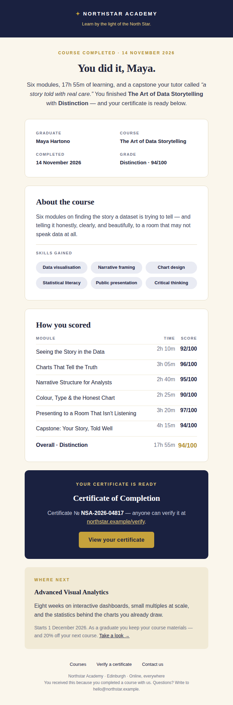
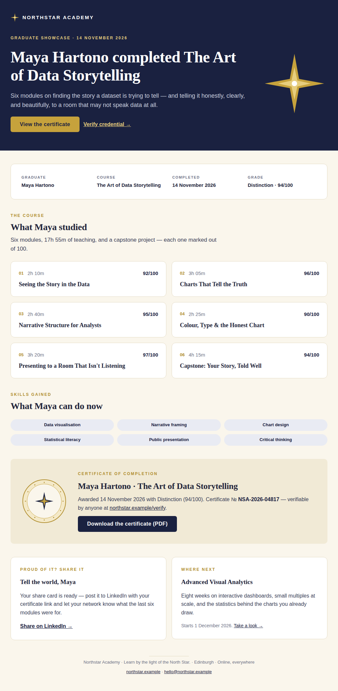
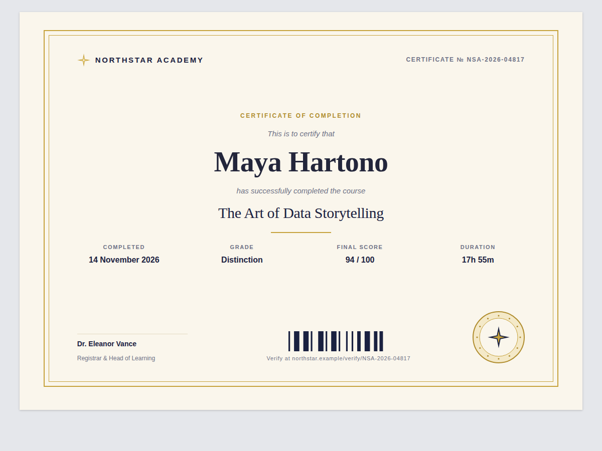

# Northstar Academy — Course Completion Kit

> **Entry for the [Hyper Elements Template Challenge](https://github.com/hyper-elements/hyper-elements/discussions/new?category=challenge-submissions)** — one fictional online academy, one graduate, one course, and everything a completion deserves: a congratulations email, a graduate showcase page, a printable certificate (HTML + PDF), and a LinkedIn share card (PNG + SVG). All four outputs are written once in Hyper Elements, from a single data file and a single theme.

Northstar Academy is fictional; the graduate is fictional too. **Maya Hartono** has just finished *The Art of Data Storytelling* — six modules, 17h 55m of learning, Distinction with 94/100. This kit is what the academy sends her, publishes about her, awards her, and helps her share.

## The four outputs

### 1. Congratulations email (600px, + plain-text twin)



Sent the moment a course is completed: the news, the course summary, the module scores as a table, the certificate-ready notice with a button, and a next-course suggestion. `render()` also writes the plain-text twin (`out/email.txt`).

### 2. Graduate showcase page (960px)



A public page celebrating the graduate: hero with the North Star drawn in Svg shapes, the course and its modules in a grid, skills gained, a certificate preview panel with the academy seal, and a nudge to share it.

### 3. Certificate of completion (A4 landscape → print HTML + PDF)



A formal certificate with a double gold frame: the graduate's name in large serif, the course, date and grade, the registrar's signature line, the academy seal drawn in Svg, and a barcode generated from the certificate ID as Svg shapes. Rendered to print HTML and to PDF with `renderPdf()` (`out/certificate.pdf`).

### 4. LinkedIn share card (1200 × 627 → PNG + SVG)


A poster-style "I completed…" card: course title, graduate, grade, and the North Star in a field of small stars — all drawn shapes, no image assets. Rendered with `renderImage()` as a 2× PNG (`out/share-card.png`) and as SVG (a copy of the build's own output, `docs/share-card.svg`, embedded above).

## How Hyper Elements was used

- **One theme, four roots.** `src/theme.ts` defines the brand once with `defineTheme()` — deep indigo, old gold and warm paper; Merriweather serif headings with Lato sans body; named styles (`card`, `paperPanel`, `eyebrow`, `metaLabel`, `chip`, `goldRule`); a type scale per heading level; and a `formats.email` override that sits headings a touch smaller in the narrower email. The `Email`, `Page`, `Document` and `Canvas` roots all take it.
- **One data model.** `src/data.ts` is the single source of truth: learner, course, six modules with durations and scores, skills gained, grade, completion date, certificate ID, academy details. Every template reads from it.
- **Shared `component()` blocks.** `src/components.tsx` holds the blocks reused across roots: `Wordmark` (drawn Svg star on page/document/canvas, text star in the email, where Svg isn't allowed), `GraduateFacts`, `SkillList`, `CertificateSeal`, `CompassStar`/`StarShape`, and `Barcode` — a deterministic barcode drawn from the certificate ID as `Rect` shapes.
- **Drawn visuals, zero image assets.** Every visual is a Hyper Elements element or an Svg shape: the compass star, the seal's rings and dots, the barcode, the star field. There are no `<Image>`s and no external image URLs anywhere.
- **The four roots, one build.** `scripts/build.tsx` validates all four templates as a build gate (any error fails the build; warnings are printed), then renders the email HTML + plain text, the page HTML, the certificate print HTML + PDF via `renderPdf()`, and the share card PNG + SVG via `renderImage()`.
- **Email-client checks and previews.** The email is validated with the `@hyper-elements/email-clients` plugin, and `renderInEmailClients()` writes per-client previews to `out/clients/` — `outlook.html`, `gmail.html` (plus `.mac` variants) and `apple-mail.html` — showing the email as each client draws it.
- **Styles the Elements way.** Styles live in `style={{…}}` only, never as props; spacing is parent `gap` (no margins); roots take `width` as a prop and carry no padding; phone styles sit in `mobile:` blocks and the layouts stack on phones.

## Run it

Requires Node.js 20+.

```bash
npm install
npm run build        # validate + render everything into out/
```

Other commands:

```bash
npm run typecheck    # tsc --noEmit
npm run screenshots  # Playwright screenshots of every output into docs/screenshots/
                     # (needs Chromium once: npx playwright install chromium)
```

The build needs no network and no API keys: fonts for the PDF/image renderers are local TTFs in `fonts/` (see `fonts/README.md`), and the HTML outputs reference the same families as webfonts.

## Project structure

```
northstar-academy/
├── src/
│   ├── data.ts        the single source of truth (graduate, course, academy)
│   ├── theme.ts       defineTheme(): palette, fonts, named styles, formats
│   ├── components.tsx shared blocks: Wordmark, GraduateFacts, SkillList,
│   │                  CertificateSeal, CompassStar, Barcode
│   ├── fonts.ts       woff2 webfonts for the HTML outputs
│   ├── email.tsx      Email root — the congratulations email (600px)
│   ├── page.tsx       Page root — the graduate showcase page (960px)
│   ├── document.tsx   Document root — the A4 landscape certificate
│   └── canvas.tsx     Canvas root — the 1200 × 627 share card
├── scripts/
│   ├── build.tsx      validate (build gate) + render everything into out/
│   └── screenshot.ts  Playwright screenshots into docs/screenshots/
├── fonts/             local TTFs for renderPdf()/renderImage() (OFL)
├── docs/screenshots/  screenshots of every rendered output
└── out/               build outputs (email, page, certificate, share card,
                       email-client previews) — regenerated by npm run build
```

## Make it yours

Change the graduate or the course in **`src/data.ts`** — the learner's name, the course title and description, the modules (titles, durations, scores), the skills, the grade and score, the completion date, the certificate ID, the academy details — then run `npm run build`. All four outputs update together, because they all read from that one file. The brand lives in `src/theme.ts`: change the palette, the fonts or the named styles there and every root follows.

## Licence

MIT — see [LICENSE](LICENSE). Fonts are under the SIL Open Font License; see [fonts/README.md](fonts/README.md).
